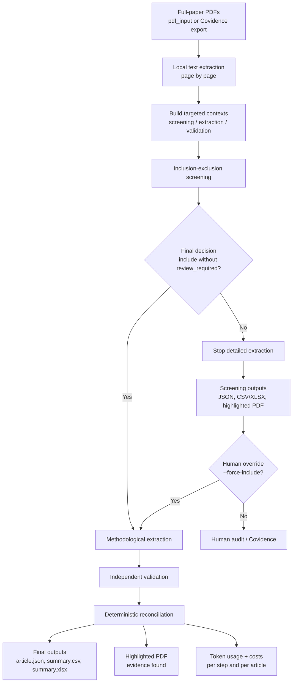
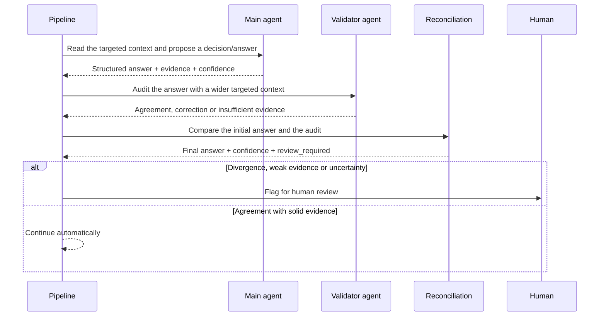
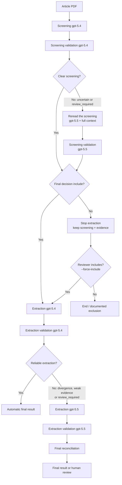
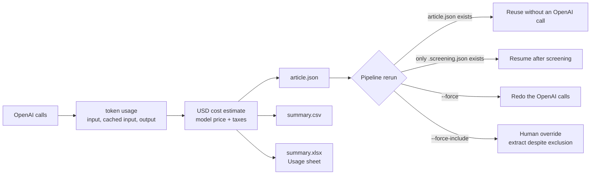

# Review Extraction

[Version française](README.md)

MVP for automatically extracting methodological parameters from PDF articles in a systematic review, with validation by an independent second agent.

**Two modes**: the API pipeline (described below), or a Claude Code agent running on a Claude subscription, with no API and no screening (see "Two ways to run it").

The API pipeline produces:

- a full-paper inclusion/exclusion screening before extraction;
- targeted reading of the useful passages to reduce the tokens sent to the API;
- study metadata with evidence and confidence;
- an adaptive extraction that sends only the relevant methodological blocks to the AI;
- one screening JSON per article;
- an Excel file `summary.xlsx` with sheets `Summary`, `Screening`, `Extraction` and `Review required`;
- a structured JSON per article and per question;
- a summary CSV for the review;
- a final confidence;
- the textual evidence used;
- a `review_required` flag;
- a highlighted PDF when the quotes can be found in the document.

The upstream phase applies this grid:

- population: include healthy or non-healthy human populations; exclude animal studies;
- outcome: include shoulder kinematics/posture; exclude upper limb without the shoulder;
- study design: include primary prospective research; exclude reviews, secondary/retrospective analyses and proceedings;
- language: include articles in English.

Detailed extraction runs only if the final screening is `include` with no human review required. Excluded or uncertain articles keep a `*.screening.json`, a row in `summary.csv`, and a PDF highlighted with the screening evidence if highlighting is enabled.

## Two ways to run it

| | API pipeline (`review-extract`) | Subscription agent (`/extract-articles`) |
|---|---|---|
| Provider | OpenAI (default), or Claude via `--backend` | Claude Code, Pro/Max subscription, **no API** |
| Screening | yes (then extraction if `include`) | **no**: inclusion was done by humans |
| Agents | extractor + independent validator + model escalation | a single extractor with a frozen configuration (protocol) |
| Cost | billed per token | subscription usage limits |
| Output | `<article>.json`, `summary.csv/xlsx` | **same format** `<article>.json`, `summary.csv/xlsx`, plus `binary.csv` |

The rest of this README describes the API pipeline (screening, adaptive extraction, benchmark...). The next section describes the subscription mode, used for the current review (extraction only, per the "AI-assisted data extraction and validation" protocol).

## Extracting parameters without the API (Claude subscription)

### Principle
The LLM is a **Claude Code subagent** (`.claude/agents/review-extractor.md`) running in your Claude Code app, which is already signed in to your subscription: no API key, no per-token billing. The Python code only does the deterministic parts (PDF text, checks, export). The model is pinned in the agent (`claude-sonnet-5-5`) so the configuration can be frozen and archived.

### Flow for one article
1. **`prepare`** (Python, no AI call): extracts the PDF text and writes, in `agent_work/<article_id>/`:
   - `context.txt`: targeted passages for the methodological parameters;
   - `metadata_context.txt`: targeted passages for the study metadata;
   - `pages.txt`: full text by page (consulted only if the targeted context is not enough);
   - `form.md`: the form (53 items with allowed answers and guidance, 21 metadata fields, output format);
   - `extraction.template.json`: a template listing every `item_id` and `field_id`.
2. **The agent reads** `form.md` and then the context, and fills `extraction.json`: for each item, an answer among the allowed identifiers (a list for multiple-response items), a confidence, an exact quote with page number, a short rationale and `needs_human_review`. Rules: never guess (`unclear`, `no_method_or_reference`, `not_assessed`, `not_reported`), never invent a quote. Default negative answers (`no`, `no_method_or_reference`, `not_assessed`, `not_applicable`, `not_reported`, `NR`) need no quote.
3. **`finalize`** (Python): rejects the file while an item is missing, unknown or duplicated, or while an answer is not in the allowed list (the agent must fix it and rerun). It checks that every quote appears verbatim in the PDF: a quote that cannot be found is dropped and the item is flagged `review_required`. It writes `<article>.json` (empty screening, `validator_status=none`) and then regenerates `summary.csv`, `summary.xlsx` and `binary.csv`.

`review_required` is `true` if the agent asks for it, if confidence is below 0.75, or if a non-default answer has no verified quote.

### Running the extraction
1. Open Claude Code signed in to your subscription (the Claude Code app, or `claude` then `/login` in a terminal) and open the session **in the repository folder** (the agent and the command are loaded at startup).
2. Put the PDFs in a folder, named after the study identifiers (e.g. `cov1063.pdf`).
3. Run:

```text
/extract-articles pdf_input outputs_claude_agent
```

The command skips PDFs that are already processed (so it resumes after a subscription limit), launches one subagent per PDF, 3 at a time, and then reports the number of answers to review. For a single article, ask the `review-extractor` agent with the PDF path. The Python steps can also be run by hand:

```powershell
review-agent-io prepare ".\pdf_input\cov1063.pdf" --work agent_work
review-agent-io finalize ".\pdf_input\cov1063.pdf" --work agent_work --out outputs_claude_agent
```

### Command-line variant: `--backend claude-cli`
The full Python pipeline (with screening, validator and escalation) can also use the subscription through the `claude -p` CLI (see "Claude backends"). For the current review we use the agent above, since there is no screening and the configuration is frozen.

### Outputs
- `outputs_claude_agent/<article_id>.json`: the pipeline's `ArticleResult` format (compatible with `review-study-pages` and `review-model-benchmark`);
- `summary.csv` / `summary.xlsx`, sheet `Review required`;
- `binary.csv`: one row per article, single-choice items as a categorical column, multiple-response items as 0/1 columns `item__option`.

### Limitations
- **Reproducibility**: temperature cannot be set with the subscription. Archive the full model ID, the Claude Code version (`claude --version`), the prompt (`.claude/agents/review-extractor.md`), the form (`form_schema.py`) and the decision rules.
- **Volume**: a trial on one article used about 89,000 tokens (subagent, Sonnet). For the roughly 1,485 remaining articles, measure on 3-5 articles first before planning: subscription limits may require several days (resuming is automatic), or may justify an API key / the Batch API for the final corpus.
- **No second model**: no validator and no automatic escalation; reliability is measured with the human sample (next sections).

## Open decisions and actions

### Open decisions
1. **Coding rules** (to be settled, e.g. by Florent, before freezing the prompt):
   - a global ISB statement without a detailed method: `isb_explicit_no_method` or `no_method_or_reference`?
   - a single sensor on the sternum: is the thorax "used"?
   - `number_shoulders` when only one arm is measured (1, `NR`, other?);
   - an alternative axial rotation (NSAR) alongside the ISB one: how to code it in the rotation details?
2. **Multiple-response items**: `*_translation_details` and `thorax_axes_orientation_details` are treated as single-choice (the form does not say "Select all"). Confirm.
3. **Domain suitability rule**: the protocol does not specify it; the current implementation is that all evaluable variables in the domain pass kappa >= 0.80 and agreement >= 90%. Rare binary variables risk failing. Confirm or relax.
4. **Kappa CI**: percentile bootstrap (1,000 replicates) instead of Donner and Eliasziw (dichotomous only). Confirm the wording in the methods.
5. **Size and strata**: the drawn sample is 165/1650 (39/29/97) rather than 170 (40/30/100), with the single stratum `year_bin`. Confirm, or add a stratum (population, measurement method).
6. **"Prespecified" tuning criteria**: define what stops the iteration (e.g. per-domain thresholds on the tuning set) before the first iteration; maximum 5.
7. **Configuration to freeze**: model (`claude-sonnet-5-5` or another), reasoning effort, subscription or API for the final corpus.
8. **Human consensus**: who is the third reviewer, and how the two reviewers are calibrated.
9. **Repository visibility**: public; `validation_study/validation_sample.csv` publishes the test-set list. Make the repository private or remove this file if the test set must stay blinded.

### Actions to do
- [ ] Obtain the 165 sample PDFs, named `cov<number>.pdf`.
- [ ] Send `validation_study/human_extraction_rater_A.xlsx` and `_B.xlsx` to the two reviewers (blinded extraction), then build the human consensus.
- [ ] Apply decisions 1 and 2 to the agent prompt and to the reviewers' guide.
- [ ] Measure consumption on 3-5 articles (`/extract-articles`).
- [ ] Iterate on development (39) then tuning (29): `review-agreement --subset tuning`, 5 iterations maximum.
- [ ] Freeze the configuration (dated manifest: model, Claude Code version, prompt, form, rules). **Not implemented**: to be added.
- [ ] Evaluate the test set (97) once: `review-agreement --subset test --final-evaluation`.
- [ ] Extract the remaining corpus; domains that are not suitable stay under human verification.
- [ ] Optional: an `--extraction-only` mode for the API pipeline (today screening always runs there); test `--backend anthropic` with a real key.

## Targeted reading to reduce tokens

Before each OpenAI call, the pipeline extracts the text page by page and builds a targeted context:

- screening: abstract/methods pages and passages mentioning population, outcome, study design, shoulder, human/animal, review/proceedings;
- extraction: passages on methods, instrumentation, markers/sensors, thorax/clavicle/scapula/humerus segments, coordinate systems, ISB, Euler sequences, translations/rotations;
- validation: the second agent stays independent and receives a wider targeted context than the first agent.

If the targeted screening stays `uncertain` or asks for `review_required`, the pipeline reruns only the screening with the full PDF context. This keeps a safety net for hard cases without rereading everything for simple articles.

The console shows the volume sent:

```text
[1/12] article.pdf: target screening context: 18000/52000 chars (35%), pages 1, 2, 4, 5
[1/12] article.pdf: target extraction context: 29000/52000 chars (56%), pages 1, 3, 4, 5, 6
```

## Token and cost tracking

Each OpenAI response normally includes a `usage` counter. The pipeline records it in the article's final JSON and prints it in the console:

```text
[1/12] article.pdf: usage screening: model=gpt-5.5, input=18432, cached_input=1024, output=912, total=19344, cost=$0.119520
[1/12] article.pdf: usage extraction: model=gpt-5.4, input=28120, cached_input=0, output=4210, total=32330, cost=$0.184300, elapsed=42.31s
[1/12] article.pdf: article usage: input=62100, cached_input=2048, output=8420, total=70520, cost=$0.587300, ai_elapsed=135.42s, processing=141.03s
```

The exports add:

- `summary.csv`: columns `usage_input_tokens`, `usage_cached_input_tokens`, `usage_output_tokens`, `usage_total_tokens`, `usage_estimated_cost_usd`, `ai_elapsed_seconds`, `processing_seconds`;
- `summary.xlsx`: sheet `Usage` with one row per step (`screening`, `screening_validation`, `extraction`, `extraction_validation`) and its `elapsed_seconds`.

Costs are computed automatically from the model used (`gpt-5.5`, `gpt-5.4`, `gpt-5.4-mini`, etc.) with OpenAI Standard / Short context prices and taxes. By default the tax rate is the Quebec one: 14.975%.

```text
OPENAI_TAX_RATE=0.14975
```

The `OPENAI_*_COST_PER_1M` variables still exist as optional overrides if prices change, but they can stay empty.

To see the price table used by the code:

```powershell
review-pricing
```

## Claude backends (subscription or Anthropic API)

`--backend` (or `REVIEW_BACKEND` in `.env`) selects the provider; the pipeline stays the same:

- `openai` (default): the OpenAI API, as before;
- `claude-cli`: Claude Code in non-interactive mode (`claude -p`), billed to the Pro/Max subscription, with no dollar cost. Prerequisite: Claude Code installed and signed in (`claude`, then `/login`); otherwise set `CLAUDE_CLI_PATH`;
- `anthropic`: the Anthropic API (`pip install -e ".[anthropic]"`, `ANTHROPIC_API_KEY` in `.env`).

```powershell
review-extract .\pdf_input --out .\outputs_claude --backend claude-cli --workers 1 --limit 3 --no-highlight
```

Default models: `claude-sonnet-5-5` (extraction/validation) and `claude-opus-5-5` (escalation). Override with `--model` etc. or `CLAUDE_MODEL`, `CLAUDE_VALIDATOR_MODEL`, `CLAUDE_FALLBACK_MODEL`, `CLAUDE_FALLBACK_VALIDATOR_MODEL`; `CLAUDE_EFFORT` sets the CLI's reasoning effort.

Notes:
- with `claude-cli`, tokens are counted but the cost is empty (subscription); when the plan limit is reached, rerunning the same command resumes from the existing JSON;
- for a reproducible protocol, archive the full model ID and the CLI version (`claude --version`); temperature cannot be set through the CLI;
- keep `--workers` low (1-2) to spare the subscription limits.

## Validation study (AI-assisted extraction protocol)

1. **A priori sample** (before any prompt work): a stratified random 10% sample, split into development / tuning / test (40/30/100 scaled), with blank Excel templates for two blinded human reviewers:

```powershell
review-sample .\pdf_input --out .\validation_study --strata-cols year_bin
```

   Outputs: `validation_sample.csv`, `sample_manifest.json` (seed, sizes, population hash), `human_extraction_rater_A.xlsx` and `_B.xlsx` (dropdown lists + a `Codebook` sheet). An existing sample is never redrawn without `--force`. `--results <JSON folder>` also lets you stratify on study metadata (e.g. `--strata-cols year_bin,population_type`).

   The review's actual sample (1,650 included studies, 165 drawn, seed 20260101, stratum `year_bin`; 39 development / 29 tuning / 97 test) is in `validation_study/`. The slim list `included_studies.csv` (no abstracts or reviewer notes) reproduces exactly the same draw:

```powershell
review-sample validation_study\included_studies.csv --out validation_study --id-col article_id --year-col "Published Year" --label-cols "Study,Title" --strata-cols year_bin --force
```

2. **Wide table with binary variables** (multiple-response items, "Select all", become 0/1 columns `item__option`):

```powershell
review-binary --results .\outputs_claude_agent
```

   `binary.csv` is also regenerated by the agent after each article (`review-agent-io finalize`).

3. **Agreement** (exact % + Wilson CI, unweighted Cohen's kappa + 95% bootstrap CI, thresholds kappa >= 0.80 and agreement >= 90%, verdict per domain):

```powershell
review-agreement --a human_consensus.xlsx --b .\outputs_claude_agent\binary.csv --sample .\validation_study\validation_sample.csv --subset tuning --out .\agreement_tuning
review-agreement --a rater_A.xlsx --b rater_B.xlsx --label human_vs_human --out .\agreement_human
review-agreement --a human_consensus.xlsx --b .\outputs_claude_agent\binary.csv --sample .\validation_study\validation_sample.csv --subset test --final-evaluation --out .\agreement_test
```

   The `test` subset requires `--final-evaluation` and can be evaluated only once (lock file). A domain is declared suitable only if all of its evaluable variables pass both thresholds.

## Installation

```powershell
conda env create -f environment.yml
conda activate review-extraction
copy .env.example .env
```

Add your key to `.env`:

```text
OPENAI_API_KEY=sk-...
```

## CLI usage

```powershell
review-extract .\pdfs --out .\outputs
```

Or for a single PDF:

```powershell
review-extract .\paper.pdf --out .\outputs
```

Useful options:

```powershell
review-extract .\pdfs --out .\outputs --no-highlight
review-extract .\pdfs --out .\outputs --model gpt-5.4 --validator-model gpt-5.4 --fallback-model gpt-5.5 --fallback-validator-model gpt-5.5
review-extract .\pdf_input --out .\outputs_hybrid_10 --limit 10 --workers 2 --no-highlight
```

If a reviewer decides that an article excluded by the screening should be included anyway, use the human override:

```powershell
review-extract ".\pdf_input\article.pdf" --out ".\outputs_reviewer_overrides" --force --force-include
```

`--force-include` keeps the screening details in the JSON but forces extraction of the metadata and methodological parameters. Preferably use it on a single PDF or on a small batch explicitly validated by the reviewers.

To estimate the cost and time of the hybrid approach on 10 articles without highlighting:

```powershell
review-extract .\pdf_input --out .\outputs_hybrid_10 --limit 10 --workers 2 --no-highlight
```

The end of the console gives the total and the per-article average:

```text
Processed 10 PDF(s).
Estimated API cost: $3.245100 ($0.324510/article).
LLM elapsed time: 1324.20s (132.42s/article).
Processing time: 1390.15s (139.02s/article).
```

## Recommended hybrid strategy

By default the pipeline uses a hybrid strategy:

- initial screening: `gpt-5.4`;
- screening validation: `gpt-5.4`;
- if the screening stays `uncertain` or asks for `review_required`: rerun screening + validation with `gpt-5.5` on the full context;
- detailed extraction: `gpt-5.4` only if the final screening is clear;
- if the extraction diverges, is insufficiently supported or asks for `review_required`: rerun extraction + validation with `gpt-5.5`.

Matching `.env` variables:

```text
OPENAI_MODEL=gpt-5.4
OPENAI_VALIDATOR_MODEL=gpt-5.4
OPENAI_FALLBACK_MODEL=gpt-5.5
OPENAI_FALLBACK_VALIDATOR_MODEL=gpt-5.5
```

The console states explicitly when an escalation to `gpt-5.5` is triggered.

## Study metadata

For included articles, the AI also extracts the following descriptive fields:

- Study ID, first author, year, title, journal, DOI;
- study design/purpose, country of data collection, source used to identify the country;
- population type, condition studied, number of participants, number of shoulders;
- age, sex distribution, side studied;
- movement/task, active/passive movement, main plane of movement;
- ISB recommendation cited, data availability.

Each field is stored in the article JSON with `value`, `confidence`, `evidence` and `rationale_short`.

Older JSON files generated before this feature will not have these fields. To add them, rerun the analysis of the affected articles with `--force`, or use a new output folder.

## Adaptive extraction

Before the detailed extraction, the pipeline does a short planning step to identify which blocks are actually present:

- `measurement_methods`;
- segments: `thorax`, `clavicle`, `scapula`, `humerus`;
- joints: `thorax_global`, `clavicle_thorax`, `scapula_clavicle`, `scapula_thorax`, `humerus_scapula`, `humerus_thorax`.

Blocks that are `present` or `unclear` are sent to the extractor and the validator. Blocks that are clearly `absent` are filled automatically with conservative answers (`no`, `not_assessed`, `no_method_or_reference`) and remain visible in the exports with `validator_status=auto_absent`.

Validation against the reference Word file `Test_paperX_XX.docx`: the form covers measurement methods, the thorax/clavicle/scapula/humerus segments, orientation/construction axes, SCS origin, joints, rotations/translations and the optional sub-details of the form.

To speed up several articles, use:

```powershell
review-extract .\pdf_input --out .\outputs --workers 2
```

Each worker creates its own OpenAI agent to avoid mixing token/cost usage between articles. Increase `--workers` gradually if you do not hit rate limits.

## Reading pages per study

A post-hoc output creates a "Covidence page" style Excel workbook, with one tab per study and a compact layout for reading/review:

```powershell
review-study-pages --results .\outputs_hybrid_10 --out .\study_pages
```

For a format closer to the Word file, with answer choices, screening first and a separate column for the evidence used:

```powershell
review-study-pages --results .\outputs_hybrid_10 --out .\study_pages_hybrid_10_choice --choice-format
```

This format contains, in each tab:

- `1. Screening`;
- `2. Study-level data`;
- `3. Word extraction form`;
- `Allowed choices / coding`;
- `Selected answer`;
- `Evidence used`;
- `Confidence`, `Review required`, `Status` and `Rationale / notes`.

To split the workbooks by the first letter of the Study ID:

```powershell
review-study-pages --results .\outputs_hybrid_10 --out .\study_pages --split-by-letter
```

Each tab combines the metadata, the screening decision, the criteria, the extraction answers, the validation statuses and the `review_required` items. The page is set to landscape and fit-to-one-page to make printing or quick reading easier.

## Resuming without rerunning the AI

By default, the CLI reuses the files already present in `outputs`:

- if `article.json` exists, no OpenAI call is made again for that article;
- if only `article.screening.json` exists, the screening is reused and the pipeline resumes at the detailed extraction if it is allowed;
- highlighted PDFs, `summary.csv` and `summary.xlsx` can be regenerated from the existing JSON.

Resume command:

```powershell
review-extract .\pdf_input --out .\outputs
```

The console shows progress:

```text
Found 12 PDF(s) to process.
[1/12] article.pdf: reuse existing JSON: article.json
[1/12] article.pdf: done
[2/12] other_article.pdf: extract PDF text
[2/12] other_article.pdf: screen full paper
```

To force a new analysis and ignore the existing JSON:

```powershell
review-extract .\pdf_input --out .\outputs --force
```

To rerun an article that reviewers want to include despite an AI exclusion:

```powershell
review-extract ".\pdf_input\article.pdf" --out ".\outputs_reviewer_overrides" --force --force-include
```

This is useful after a human review of the screening. The output can then be turned into an Excel page:

```powershell
review-study-pages --results ".\outputs_reviewer_overrides" --out ".\study_pages_reviewer_overrides" --choice-format
```

## Model benchmark

The current JSON files in `outputs` can serve as a 5.5 reference to compare candidate models:

```powershell
review-model-benchmark .\pdf_input --reference-out .\outputs --out .\benchmark_outputs --models gpt-5.4 gpt-5.4-mini
```

The benchmark automatically picks the right prices per model and applies `OPENAI_TAX_RATE`.

To test on a few articles first:

```powershell
review-model-benchmark .\pdf_input --reference-out .\outputs --out .\benchmark_outputs --models gpt-5.4 gpt-5.4-mini --limit 3
```

The results are written to:

- `benchmark_outputs\benchmark_summary.csv`
- `benchmark_outputs\benchmark_articles.csv`
- `benchmark_outputs\benchmark_disagreements.csv`
- `benchmark_outputs\benchmark.xlsx`

If candidate outputs already exist, they are reused. To compare without any OpenAI call:

```powershell
review-model-benchmark .\pdf_input --reference-out .\outputs --out .\benchmark_outputs --models gpt-5.4 gpt-5.4-mini --compare-only
```

## Exchanges with Covidence

Covidence is treated here as a source/destination of files. The robust flow is:

1. download from Covidence a folder or ZIP containing the full texts;
2. copy the PDFs into `pdf_input`;
3. run `review-extract`;
4. export the decisions and extractions as CSV/XLSX files readable by Covidence or for archiving.

Import the PDFs from a Covidence folder or ZIP:

```powershell
review-covidence import-pdfs .\covidence_download --out .\pdf_input
review-covidence import-pdfs .\covidence_download.zip --out .\pdf_input
```

The command also creates a manifest:

```text
pdf_input\covidence_pdf_manifest.csv
```

Export the results to transfer files:

```powershell
review-covidence export-results --results .\outputs --out .\covidence_export
```

Files produced:

- `covidence_export\covidence_screening_results.csv`
- `covidence_export\covidence_extraction_results.csv`
- `covidence_export\covidence_results.xlsx`

Current limitation: without an official Covidence API configured here, the project does not connect directly to the Covidence site. This avoids fragile browser/login automation and goes through file exports/imports instead.

## Tests

The unit tests use `unittest`, so they can run without `pytest`:

```powershell
python -B -m unittest discover -s tests -v
```

## Local API

```powershell
uvicorn review_extraction.api:app --reload
```

Then upload a PDF:

```powershell
curl -X POST "http://127.0.0.1:8000/extract" -F "file=@paper.pdf" -F "output_dir=outputs"
```

## Architecture diagrams

### Overall flow



### Agent cooperation



The second agent is not there to rephrase the first: it audits the answer, looks for missing evidence and can correct the item. Reconciliation is deliberately simple and traceable: agreement + evidence raises confidence; divergence, low confidence or insufficient evidence triggers `review_required`.

### Hybrid model routing



This strategy keeps `gpt-5.4` as the working model to limit costs, then reserves `gpt-5.5` for uncertain, complex or divergent articles.

### Outputs, costs and resuming



The JSON files are the local source of truth. They let you regenerate the exports and resume an analysis without paying again for calls that are already done.
